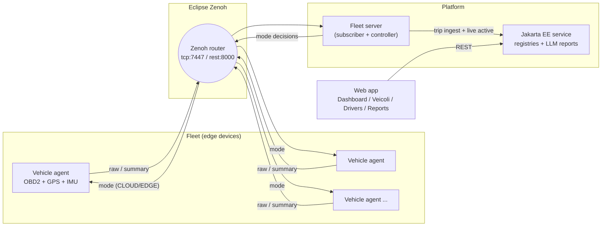

# CoreFleet SDV

**Adaptive cloud–edge fleet telemetry over Eclipse Zenoh, with LLM-generated driving reports.**

CoreFleet SDV is a hackathon project for the [CEI-Sphere Hackathon — Code the Continuum](https://ceisphere.eu/events/code-continuum). It combines **Challenge 1 (Eclipse Zenoh & Sustainable Edge-Cloud)** and **Challenge 3 (Jakarta EE, AI & the Hourglass Model)** into a single, coherent product.

---

## 1. The Concept

CoreFleet is a fictional **taxi-sharing / car-sharing startup**. We own the vehicles and lease them to drivers (taxi operators or subscribers). Every car carries an **IoT edge device** (OBD2 reader + accelerometer + GPS) that streams live telemetry back to our platform.

The platform must scale to a large, growing fleet **without saturating the network or wasting energy**. To do that, it continuously chooses, per the current network pressure, *how* each vehicle should transmit:

- **`CLOUD` mode**: the device streams raw telemetry every second. The server does all the processing. Maximum fidelity, maximum bandwidth.
- **`EDGE` mode**: when the server detects that many vehicles are active and the channel is saturating, it instructs devices to **aggregate locally** and send a compact summary every 15 seconds instead. Drastically lower bandwidth and transmission energy, at the cost of temporal resolution.

The server arbitrates this trade-off in real time. A web app shows the connected fleet with **live telemetry** plus vehicle and driver registries; **on demand**, an **LLM-backed Jakarta EE service** produces a structured report on how each **driver** drives and treats the company's cars.

This directly mirrors the Challenge 1 narrative: *comparing "cloud-only" vs "edge-accelerated" deployments and measuring bandwidth/energy savings*, while the driver reports fulfil Challenge 3.

---

## 2. Why It Matters

The core insight of the cloud–edge continuum is that **moving computation toward the data source reduces the volume that must travel across the network**, which reduces both bandwidth cost and transmission energy. CoreFleet makes this tangible:

- It **measures** the bytes/second produced in each mode and estimates the transmission energy saved (`JOULES_PER_MB`).
- It **adapts automatically**: the system is not statically "cloud" or "edge", it shifts along the continuum based on live load.
- It keeps a **defensible separation of concerns**: physically-grounded numbers come from the telemetry pipeline; the LLM only writes the human-facing narrative on top of those numbers.

---

## 3. Architecture



### Components

| Component | Path | Role | Status |
|---|---|---|---|
| **Shared library** | `corefleet/` | Zenoh protocol (keys, modes, codec) + `VehicleClient`, imported by both vehicle and server. | ✅ |
| **Fleet simulator** | `fleet_simulator/` | Simulates **cars** (assets) + **drivers** (people) + **trips**; each active trip is an agent streaming OBD2/GPS over Zenoh. | ✅ |
| **Zenoh router** | `zenoh_router/` | Dockerized Eclipse Zenoh router (wire `:7447`, REST `:8000`). | ✅ |
| **Fleet server** | `zenoh_router/subscriber/fleet_server.py` | Subscribes to telemetry, detects congestion, publishes mode decisions, scores each trip and ingests it into the registry service. | ✅ |
| **Dashboard** | `webapp/` | Vue 3 control-room UI: Dashboard, **Veicoli**, **Drivers**, **Reports** (history), About. | ✅ |
| **Jakarta EE + LLM service** | `report-service/` | Open Liberty + langchain4j; vehicle & driver registries, on-demand cached driver reports, Hourglass mapping. | ✅ |
| **Live map** | _planned_ | Fleet positions (Leaflet / MapLibre) fed from `lat`/`lon`. | ⏳ |

---

## 4. Zenoh Protocol

`vid` = vehicle id (the licence plate). All keys live under the `core/fleet` namespace.

| Key expression | Direction | Payload | Mode | Notes |
|---|---|---|---|---|
| `core/fleet/{vid}/alive` | Vehicle → Server | _liveliness token_ | — | Declared on ignition. Auto-undeclared (DELETE sample) on disconnect → free crash detection. |
| `core/fleet/{vid}/raw` | Vehicle → Server | JSON telemetry | `CLOUD` | One sample per second. |
| `core/fleet/{vid}/summary` | Vehicle → Server | JSON aggregate | `EDGE` | One sample per 15-second window. |
| `core/fleet/{vid}/session` | Vehicle → Server | JSON aggregate | — | Final full-session aggregate, published once on trip end; triggers the trip ingest into the registries. |
| `core/fleet/mode` | Server → Vehicles | `"CLOUD"` \| `"EDGE"` | — | Global mode. Exposed as a **queryable** so vehicles joining mid-run can read the current value, then subscribe for changes. |

The server subscribes with wildcards: `core/fleet/*/raw`, `core/fleet/*/summary`, `core/fleet/*/session`, `core/fleet/*/alive`, so it scales to any number of vehicles without per-vehicle subscription bookkeeping. The end-of-trip ingest is triggered by the `session` payload (an explicit end-of-drive event), so it is independent of liveliness-message ordering.

Every payload also carries the **driver** taking the trip (`did`, `driver_name`) and the **trip id** (`trip_id`). The final `session` payload additionally carries the driver's anagrafica (`driver_surname`, `driver_cf`, `driver_nationality`) and a `vehicle` snapshot (`odo_km`, `fuel_pct`, `oil_pct`, `lights`) — the data the registries are built from.

> **Design notes / improvements over a naïve design**
> - **Liveliness tokens** instead of a manual `alive`/`dead` message pair: presence is tracked by Zenoh itself, so a device that crashes or loses connectivity is detected automatically.
> - **`vid` lives in the key path**, not the payload, so subscribers can filter and store per-vehicle by key expression.
> - The `mode` key is **queryable / retained** so late-joining vehicles learn the current mode immediately.
> - JSON is used for the v1 demo; a **CBOR / protobuf** encoding is planned to quantify the bandwidth win.

---

## 5. Adaptive CLOUD ↔ EDGE Logic

The server estimates instantaneous network pressure from the number of active vehicles and their per-vehicle payload rate, and switches the whole fleet's mode with **hysteresis** to avoid flapping:

```
projected_cloud_bps = active_vehicles × avg_raw_bytes × CLOUD_HZ

if mode == CLOUD and projected_cloud_bps > BW_LIMIT_BYTES_S        → publish EDGE
if mode == EDGE  and projected_cloud_bps < BW_LIMIT_BYTES_S × 0.6  → publish CLOUD
```

`avg_raw_bytes` is measured live from observed raw payloads; both thresholds are configurable via environment variables (`BW_LIMIT_BYTES_S`, `BW_HYSTERESIS`). Energy saved is estimated as `bytes_saved / 1e6 × JOULES_PER_MB` against an all-CLOUD baseline — the headline metric for the Challenge 1 comparison, printed every `STATS_INTERVAL_S` seconds.

Two aggregation scopes are maintained:

- a **rolling 15-second window** aggregate, transmitted and reset in `EDGE` mode;
- a **full-session** aggregate, accumulated for the whole trip and used for the end-of-trip ingest that feeds the driver/vehicle registries.

The default `BW_LIMIT_BYTES_S` keeps the fleet in **CLOUD** (so live 1 Hz telemetry is visible on the dashboard); lower it or raise `MAX_VEHICLES` to trigger the **EDGE** switch and watch bandwidth/energy drop (at the cost of coarser, 15 s telemetry).

---

## 6. Telemetry Data Model

### `raw` sample (CLOUD mode) — OBD2 PIDs + augmented GPS

| Field | Source | Unit |
|---|---|---|
| `vid`, `t` | — | id, seconds |
| `did`, `driver_name`, `trip_id` | trip | driver (person) + trip id |
| `speed_kmh` | PID 0x0D | km/h |
| `rpm` | PID 0x0C | rpm |
| `throttle` | PID 0x11 | % |
| `load` | PID 0x04 | % |
| `coolant_c` | PID 0x05 | °C |
| `fuel_lph` | PID 0x5E | L/h |
| `lat`, `lon` | GPS | deg |
| `limit_kmh` | map (augmented) | km/h |

The driver id/name ride on every sample so the server can serve **who is driving now** live (see `/report/api/active`).

### `summary` aggregate (EDGE window / end-of-trip session)

Distance, duration, average & max speed, average rpm, fuel used, L/100 km, and **driving-quality counters**: harsh accelerations, harsh braking, over-rev seconds, cold-engine over-rev seconds, idle seconds, speeding seconds.

The final `session` payload additionally carries the driver's anagrafica (`driver_surname`, `driver_cf`, `driver_nationality`) and a **vehicle snapshot** (`odo_km`, `fuel_pct`, `oil_pct`, `lights`) — the fields the registries are built from.

These counters are derived from physically-grounded thresholds (see `fleet_simulator/config.py`) so the downstream scores rest on real signals rather than on the LLM inventing numbers. Speeding still lowers the safety score, but a **multa** (fine) is only recorded for *sustained* speeding that gets *caught* (`FINE_MIN_SPEEDING_S`, `FINE_CATCH_RATE`).

---

## 7. Cars, Drivers & Trips

CoreFleet models the business literally:

- **Cars** are assets. The fleet starts with a batch and grows over the run. A car has an odometer, fuel and oil levels and warning lights that **persist across trips** (and is refuelled/serviced at the depot when low).
- **Drivers** are people, and they **churn**: new customers arrive continuously, and a satisfied one may **reconfirm** for a later trip (a bad experience — the car handed back with warning lights — makes them less likely to return). A returning driver rotates across different cars. Each driver has an anagrafica (nome, cognome, codice fiscale, nazionalità) and a baseline driving style. Tuned by `RECONFIRM_RATE` / `SATISFACTION_RATE`.
- A **trip** = a driver taking an available car for a finite drive. On end, both return to their pools; the same driver may later take another car.

The OBD2 device lives on the **car** (it is the telemetry source), but scoring and reporting are about the **driver** — that's the real product value (insurance/coaching follow the person).

## 8. Registries & Driver Reports (Challenge 3: Jakarta EE + LLM)

The Jakarta service (`report-service/`, Open Liberty + langchain4j, built from the Eclipse [`hourglass-template`](https://gitlab.eclipse.org/eclipse-research-labs/o-cei-project/challenge-3-jakarta-ee-hourglass/hourglass-template)) is the **platform API**. Each finished trip is **ingested** (no LLM); reports are generated **on demand, per driver, and cached**.

| Method | Path | Purpose |
|---|---|---|
| `POST` | `/report/api/trips` | Ingest a finished trip → update driver + vehicle stats. No LLM. |
| `POST`/`GET` | `/report/api/active` | Live "who is driving now" **+ live telemetry** (speed, rpm, throttle, fuel, position) per vehicle; pushed by the server every ~2s, read by the dashboard. |
| `GET`  | `/report/api/vehicles` · `/vehicles/{vid}` | Vehicle registry: km totali, n° trip, carburante/olio, spie, ultimi conducenti. |
| `GET`  | `/report/api/drivers` · `/drivers/{did}` | Driver registry: anagrafica, viaggi, km, multe/infrazioni, medie, recidivo. |
| `POST` | `/report/api/drivers/{did}/report` | Generate (or return **cached**) the driver's LLM report. |
| `GET`  | `/report/api/report` | History of generated reports. |
| `POST` | `/report/api/hourglass/analyze` | The template's generic Hourglass mapping (`{domain, useCase}`). |
| `GET`  | `/report/api/status` | Health + configured model (no secrets). |

**Caching**: a driver's report is regenerated only when their data changed since last time — the cache key is a hash of `trips + km + infractions + average scores`. Identical data ⇒ the stored report is returned with `cached: true` and **no LLM call**.

**Deterministic vs narrative**: the platform owns the numbers (scores, counts, recidivist behaviours, trend, grade); the **LLM only writes the prose** and the Hourglass mapping (stakeholders / capabilities-waist / standards groups). Reproducible and easy to defend.

The OpenAI key is read from the **`OPENAI_API_KEY`** environment variable (via a gitignored `.env`); it is never committed. See `report-service/README.md`.

---

## 9. Repository Structure

```
.
├── corefleet/                  # Shared library (vehicle + server)
│   ├── protocol.py             # Key expressions, Mode enum, JSON codec
│   └── client.py               # VehicleClient: liveliness, mode, publishers
├── fleet_simulator/            # Cars + drivers + trips simulator
│   ├── __main__.py             # Entry point: python -m fleet_simulator
│   ├── config.py               # Physical constants, driver profiles, thresholds
│   ├── fleet_simulator.py      # Runner: car/driver pools + trip scheduler
│   ├── agent.py                # VehicleAgent: one trip's physics + Zenoh loop
│   ├── vehicle_simulator.py    # Per-trip physics + raw/window/session payloads
│   ├── Dockerfile
│   └── types/                  # driver_profile, driver, vehicle_state, edge_aggregate
├── zenoh_router/
│   ├── docker-compose.yaml     # Standalone router (router only)
│   └── subscriber/
│       ├── fleet_server.py     # Subscriber + congestion controller + trip ingest
│       └── Dockerfile
├── report-service/             # Jakarta EE 11 + langchain4j (Challenge 3)
│   ├── src/main/java/dukes/    # fleet/ (registries, reports) + hourglass/ + ai/
│   └── Dockerfile              # Maven build -> Open Liberty (Java 17)
├── webapp/                     # Vue 3 dashboard (Dashboard/Veicoli/Drivers/Reports)
├── docker-compose.yaml         # Full stack: router + server + sim + report + webapp
├── .env.example                # OPENAI_API_KEY lives in a gitignored .env
├── requirements.txt
└── README.md
```

---

## 10. Getting Started

### Prerequisites
- Docker + Docker Compose (Python 3.13 / Java 17 images)
- Or, for local runs: Python 3.10+ and `pip install -r requirements.txt`

### Full stack (recommended)

Provide your OpenAI key for the report service (kept out of git):

```bash
cp .env.example .env        # then edit .env and set OPENAI_API_KEY
docker compose up --build
```

This brings up the router, fleet server, simulator, **report service** and
**dashboard**. The simulator starts with a batch of cars and grows the fleet;
new customers arrive continuously and take cars for finite trips. Watch the
`fleet-server` logs for the bandwidth/energy `[stats]` lines and `trip … ingested`
lines — each finished trip updates the driver/vehicle registries. Open the
dashboard: the **Veicoli** tab shows a running trip's **live telemetry**, and on the
**Drivers** tab you can pick a driver and press **Genera report**.

- Dashboard: **http://localhost:8080**
- Report service: **http://localhost:9080/report/api/status**
- Live "who's driving now": `…/report/api/active` · Drivers / Vehicles: `…/report/api/drivers` · `…/report/api/vehicles`
- Router REST: **http://localhost:8000** (`core/fleet/**`)

By default the fleet runs in **CLOUD**, so the dashboard shows live 1 Hz telemetry
(speed/rpm/throttle/fuel) for a running trip. Lower `BW_LIMIT_BYTES_S` (e.g. `1800`)
or raise `MAX_VEHICLES` to trigger the **EDGE** switch — you'll see `MODE -> EDGE` in
the logs, the bandwidth/energy drop in `[stats]`, and the telemetry become coarser
(15 s window aggregates).

Tunables live in `docker-compose.yaml`: `START_VEHICLES`, `MAX_VEHICLES`,
`SPAWN_INTERVAL_S`, `TRIP_MIN_S`/`TRIP_MAX_S`, `RECONFIRM_RATE`,
`SATISFACTION_RATE`, `DURATION_S` (simulator) and `BW_LIMIT_BYTES_S`,
`BW_HYSTERESIS`, `FINE_MIN_SPEEDING_S`, `FINE_CATCH_RATE`, `ACTIVE_INTERVAL_S`,
`STATS_INTERVAL_S` (server).

### Run components locally

```bash
python -m venv .venv && source .venv/bin/activate   # fish: source .venv/bin/activate.fish
pip install -r requirements.txt

# 1) router only
docker compose -f zenoh_router/docker-compose.yaml up

# 2) server  (new shell, from repo root)
ZENOH_ROUTER=tcp/localhost:7447 PYTHONPATH=. python zenoh_router/subscriber/fleet_server.py

# 3) simulator (new shell, from repo root)
ZENOH_ROUTER=tcp/localhost:7447 python -m fleet_simulator
```

---

## 11. Roadmap

- [x] **Simulator over Zenoh** — liveliness, `mode` query/subscribe, `raw`/`summary`/`session` publish.
- [x] **Fleet server / controller** — wildcard subs, hysteresis congestion control, mode queryable, per-trip scoring + ingest, bandwidth/energy stats.
- [x] **Cars + drivers + trips** — asset pool, driver **churn** (new customers + reconfirms), finite trips, drivers rotating across cars, per-car fuel/oil/odometer/lights.
- [x] **Live telemetry** — "who's driving now" + speed/rpm/throttle/fuel per running trip; cross-links between vehicles ↔ drivers.
- [x] **Jakarta registries + reports** — vehicle & driver stats, on-demand **cached** driver reports, history, Hourglass mapping (langchain4j + OpenAI).
- [x] **Vue 3 dashboard** — Dashboard, Veicoli (live trip), Drivers (with "Genera report"), Reports history.
- [x] **Full Docker stack** — router + server + simulator + report service + dashboard.
- [ ] **Live map** — fleet positions from `lat`/`lon` (Leaflet/MapLibre).
- [ ] **Persistence** — registries + reports survive a restart (currently in-memory).
- [ ] **Compact encoding** — CBOR/protobuf variant to measure the real bandwidth win.

---

## Appendix — Hackathon Challenges

### CEI-Sphere Hackathon — Code the Continuum

> Code the Continuum brings together students, developers, researchers, innovators, open-source communities, pilot teams and solution providers for two days of hands-on collaboration around the cloud-edge-IoT continuum.
>
> The event creates a practical space for experimentation, co-creation and exchange, where participants will work on real challenges related to open technologies, interoperability and the reuse of assets across large-scale pilot environments.

#### First Challenge - O-CEI: Eclipse Zenoh & Sustainable Edge-Cloud

> Participants will explore how Eclipse Zenoh can support energy-aware edge-cloud applications by comparing "cloud-only" and "edge-accelerated" deployments. Through hands-on experimentation, they will measure how optimising data flows across the continuum can reduce bandwidth usage and contribute to lower energy consumption.

- **Concrete scenarios**:
  + **Challenge 1.A**: Distributed image processing with Zenoh, comparing cloud vs edge execution.
  + **Challenge 1.B**: Geo-distributed content delivery using Zenoh and SkyFlok, comparing traffic across edge and cloud.
- **Task**: Install Zenoh client libraries (e.g. Python or Rust), run demo repositories, adapt them with your own data, and compare edge vs cloud configurations.
- **Inputs**: Example source code and demo repositories (GitHub).
- **Expected demo (Definition of Done)**: At least one scenario running successfully, with visible Zenoh message exchanges and a short explanation of results.
- **Skills**: Programming (Python, Rust, C/C++), basic networking and distributed systems knowledge.
- **Requirements**: Laptop (Windows, Ubuntu or macOS) capable of running Zenoh demos and installing development tools.
- **Mentors**: Software engineers from ZettaScale.

#### Third Challenge - ECLIPSE FOUNDATION: Jakarta EE, AI & the Hourglass Model

> Proposed by the Eclipse Foundation, this challenge invites participants to design and implement a Jakarta EE application that models and analyses enterprise domains using the [Hourglass Model](https://ceisphere.eu/hourglass-model). The mapping will be supported by an external Large Language Model (LLM), integrated through modern AI engineering and agentic techniques.

- **Concrete scenario**: Generate the Hourglass Model for a given domain and use case.
- **Task**: Design and implement a Jakarta EE application that models and analyses enterprise domains using the Hourglass Model, supported by an external LLM and agentic tools.
- **Inputs**: Skeleton project, OpenAI API key, starter guides and links to relevant resources.
- **Expected demo (Definition of Done)**: A complete, runnable Jakarta EE project.
- **Skills**: Java, Maven and general knowledge of agentic AI techniques.
- **Mentor**: Ivar Grimstad, Jakarta EE Developer Advocate, Eclipse Foundation.
