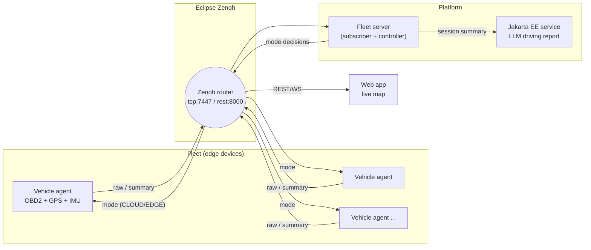

# CoreFleet SDV

**Adaptive cloud–edge fleet telemetry over Eclipse Zenoh, with LLM-generated driving reports.**

CoreFleet SDV is a hackathon project for the [CEI-Sphere Hackathon — Code the Continuum](https://ceisphere.eu/events/code-continuum). It combines **Challenge 1 (Eclipse Zenoh & Sustainable Edge-Cloud)** and **Challenge 3 (Jakarta EE, AI & the Hourglass Model)** into a single, coherent product.

---

## 1. The Concept

CoreFleet is a fictional **taxi-sharing / car-sharing startup**. We own the vehicles and lease them to drivers (taxi operators or subscribers). Every car carries an **IoT edge device** (OBD2 reader + accelerometer + GPS) that streams live telemetry back to our platform.

The platform must scale to a large, growing fleet **without saturating the network or wasting energy**. To do that, it continuously chooses, per the current network pressure, *how* each vehicle should transmit:

- **`CLOUD` mode**: the device streams raw telemetry every second. The server does all the processing. Maximum fidelity, maximum bandwidth.
- **`EDGE` mode**: when the server detects that many vehicles are active and the channel is saturating, it instructs devices to **aggregate locally** and send a compact summary every 15 seconds instead. Drastically lower bandwidth and transmission energy, at the cost of temporal resolution.

The server arbitrates this trade-off in real time. A web app renders the live fleet on a map, and at the end of every driving session an **LLM-backed Jakarta EE service** produces a structured report on how the car was driven.

This directly mirrors the Challenge 1 narrative: *comparing "cloud-only" vs "edge-accelerated" deployments and measuring bandwidth/energy savings*, while the per-session report fulfils Challenge 3.

---

## 2. Why It Matters

The core insight of the cloud–edge continuum is that **moving computation toward the data source reduces the volume that must travel across the network**, which reduces both bandwidth cost and transmission energy. CoreFleet makes this tangible:

- It **measures** the bytes/second produced in each mode and estimates the transmission energy saved (`JOULES_PER_MB`).
- It **adapts automatically**: the system is not statically "cloud" or "edge", it shifts along the continuum based on live load.
- It keeps a **defensible separation of concerns**: physically-grounded numbers come from the telemetry pipeline; the LLM only writes the human-facing narrative on top of those numbers.

---

## 3. Architecture



### Components

| Component | Path | Role | Status |
|---|---|---|---|
| **Shared library** | `corefleet/` | Zenoh protocol (keys, modes, codec) + `VehicleClient`, imported by both vehicle and server. | ✅ |
| **Fleet simulator** | `fleet_simulator/` | Physically-grounded OBD2/GPS telemetry generator; each vehicle is an independent agent streaming over Zenoh. | ✅ |
| **Zenoh router** | `zenoh_router/` | Dockerized Eclipse Zenoh router (wire `:7447`, REST `:8000`). | ✅ |
| **Fleet server** | `zenoh_router/subscriber/fleet_server.py` | Subscribes to telemetry, detects congestion, publishes mode decisions, finalizes sessions and reports bandwidth/energy. | ✅ |
| **Web app** | _planned_ | Live map of the fleet (Leaflet / MapLibre) fed from Zenoh. | ⏳ |
| **Jakarta EE LLM service** | _planned_ | Consumes a session summary and generates a Hourglass-Model driving report. | ⏳ |

---

## 4. Zenoh Protocol

`vid` = vehicle id (the licence plate). All keys live under the `core/fleet` namespace.

| Key expression | Direction | Payload | Mode | Notes |
|---|---|---|---|---|
| `core/fleet/{vid}/alive` | Vehicle → Server | _liveliness token_ | — | Declared on ignition. Auto-undeclared (DELETE sample) on disconnect → free crash detection. |
| `core/fleet/{vid}/raw` | Vehicle → Server | JSON telemetry | `CLOUD` | One sample per second. |
| `core/fleet/{vid}/summary` | Vehicle → Server | JSON aggregate | `EDGE` | One sample per 15-second window. |
| `core/fleet/{vid}/session` | Vehicle → Server | JSON aggregate | — | Final full-session aggregate, published once on shutdown; triggers the driving report. |
| `core/fleet/mode` | Server → Vehicles | `"CLOUD"` \| `"EDGE"` | — | Global mode. Exposed as a **queryable** so vehicles joining mid-run can read the current value, then subscribe for changes. |

The server subscribes with wildcards: `core/fleet/*/raw`, `core/fleet/*/summary`, `core/fleet/*/session`, `core/fleet/*/alive`, so it scales to any number of vehicles without per-vehicle subscription bookkeeping. The end-of-session report is triggered by the `session` payload (an explicit end-of-drive event), so it is independent of liveliness-message ordering.

> **Design notes / improvements over a naïve design**
> - **Liveliness tokens** instead of a manual `alive`/`dead` message pair: presence is tracked by Zenoh itself, so a device that crashes or loses connectivity is detected automatically.
> - **`vid` lives in the key path**, not the payload, so subscribers can filter and store per-vehicle by key expression.
> - The `mode` key is **queryable / retained** so late-joining vehicles learn the current mode immediately.
> - JSON is used for the v1 demo; a **CBOR / protobuf** encoding is planned to quantify the bandwidth win.

---

## 5. Adaptive CLOUD ↔ EDGE Logic

The server estimates instantaneous network pressure from the number of active vehicles and their per-vehicle payload rate, and switches the whole fleet's mode with **hysteresis** to avoid flapping:

```
projected_cloud_bps = active_vehicles × avg_raw_bytes × CLOUD_HZ

if mode == CLOUD and projected_cloud_bps > BW_LIMIT_BYTES_S        → publish EDGE
if mode == EDGE  and projected_cloud_bps < BW_LIMIT_BYTES_S × 0.6  → publish CLOUD
```

`avg_raw_bytes` is measured live from observed raw payloads; both thresholds are configurable via environment variables (`BW_LIMIT_BYTES_S`, `BW_HYSTERESIS`). Energy saved is estimated as `bytes_saved / 1e6 × JOULES_PER_MB` against an all-CLOUD baseline — the headline metric for the Challenge 1 comparison, printed every `STATS_INTERVAL_S` seconds.

Two aggregation scopes are maintained:

- a **rolling 15-second window** aggregate, transmitted and reset in `EDGE` mode;
- a **full-session** aggregate, accumulated for the whole drive (ignition → shutdown) and used to build the end-of-session report.

---

## 6. Telemetry Data Model

### `raw` sample (CLOUD mode) — OBD2 PIDs + augmented GPS

| Field | Source | Unit |
|---|---|---|
| `vid`, `t` | — | id, seconds |
| `speed_kmh` | PID 0x0D | km/h |
| `rpm` | PID 0x0C | rpm |
| `throttle` | PID 0x11 | % |
| `load` | PID 0x04 | % |
| `coolant_c` | PID 0x05 | °C |
| `fuel_lph` | PID 0x5E | L/h |
| `lat`, `lon` | GPS | deg |
| `limit_kmh` | map (augmented) | km/h |

### `summary` aggregate (EDGE mode / session report)

Distance, duration, average & max speed, average rpm, fuel used, L/100 km, and **driving-quality counters**: harsh accelerations, harsh braking, over-rev seconds, cold-engine over-rev seconds, idle seconds, speeding seconds.

These counters are derived from physically-grounded thresholds (see `fleet_simulator/config.py`) so the downstream score and report rest on real signals rather than on the LLM inventing numbers.

---

## 7. The Driving Report (Challenge 3: Jakarta EE + LLM)

When a session ends, the server hands the session summary to a **Jakarta EE** service that calls an external LLM to produce a structured report, framed as a **Hourglass Model** mapping of the driving domain:

- **Lower layer (raw)**: the telemetry stream and event counters.
- **Waist (the stable interface)**: the normalized session aggregate and the deterministic eco/safety scores.
- **Upper layer (business)**: the LLM-generated narrative: how the car was driven, eco-driving and safety feedback, maintenance hints (e.g. cold-engine over-revving), and an overall rating.

Keeping the scores deterministic and letting the LLM only write the prose makes the output reproducible and easy to defend in the demo.

---

## 8. Repository Structure

```
.
├── corefleet/                  # Shared library (vehicle + server)
│   ├── protocol.py             # Key expressions, Mode enum, JSON codec
│   └── client.py               # VehicleClient: liveliness, mode, publishers
├── fleet_simulator/            # Vehicle & fleet telemetry simulator
│   ├── __main__.py             # Entry point: python -m fleet_simulator
│   ├── config.py               # Physical constants, driver profiles, thresholds
│   ├── fleet_simulator.py      # Fleet runner: spawns/ramps vehicle agents
│   ├── agent.py                # VehicleAgent: physics + Zenoh streaming loop
│   ├── vehicle_simulator.py    # Per-vehicle physics + raw/window/session payloads
│   ├── Dockerfile
│   └── types/
│       ├── driver_profile.py   # aggressive / normal / calm profiles
│       ├── vehicle_state.py    # Live vehicle state
│       └── edge_aggregate.py   # Rolling/session aggregation + summary_dict()
├── zenoh_router/
│   ├── docker-compose.yaml     # Standalone router (router only)
│   └── subscriber/
│       ├── fleet_server.py     # Fleet server (subscriber + controller)
│       └── Dockerfile
├── docker-compose.yaml         # Full stack: router + server + simulator
├── requirements.txt
└── README.md
```

---

## 9. Getting Started

### Prerequisites
- Docker + Docker Compose (images use Python 3.13)
- Or, for local runs: Python 3.10+ and `pip install -r requirements.txt`

### Full stack (recommended)

Brings up the router, the fleet server and the simulator together:

```bash
docker compose up --build
```

The simulator starts with a few vehicles and adds one every `SPAWN_INTERVAL_S`
seconds, ramping the fleet into congestion. Watch the `fleet-server` logs for the
`MODE -> EDGE` / `MODE -> CLOUD` switches, the bandwidth/energy `[stats]` lines,
and the `SESSION REPORT` payloads emitted when vehicles shut down. The router's
REST API is exposed on `:8000` for the web app or `curl`.

Tunables live in `docker-compose.yaml`: `START_VEHICLES`, `MAX_VEHICLES`,
`SPAWN_INTERVAL_S`, `DURATION_S` (simulator) and `BW_LIMIT_BYTES_S`,
`BW_HYSTERESIS`, `STATS_INTERVAL_S` (server).

### Run components locally

```bash
python -m venv .venv && source .venv/bin/activate   # fish: source .venv/bin/activate.fish
pip install -r requirements.txt

# 1) router only
docker compose -f zenoh_router/docker-compose.yaml up

# 2) server  (new shell, from repo root)
ZENOH_ROUTER=tcp/localhost:7447 PYTHONPATH=. python zenoh_router/subscriber/fleet_server.py

# 3) simulator (new shell, from repo root)
ZENOH_ROUTER=tcp/localhost:7447 python -m fleet_simulator
```

---

## 10. Roadmap

- [x] **Wire the simulator to Zenoh** — liveliness token on start, subscribe + query `mode`, publish `raw` (CLOUD) or 15 s `summary` (EDGE), final `session` aggregate + undeclare on stop.
- [x] **Fleet server / controller** — wildcard subscriptions, congestion estimate with hysteresis, mode queryable, session finalization, bandwidth/energy stats.
- [x] **Full Docker stack** — router + server + simulator on Python 3.13.
- [ ] **Bandwidth & energy dashboard** — surface the server's CLOUD vs EDGE bytes/s and joules-saved stats in a UI (the Challenge 1 result slide).
- [ ] **Web app** — live fleet map fed from the Zenoh REST/WS endpoint.
- [ ] **Jakarta EE LLM service** — consume the `SESSION REPORT` payload and generate the Hourglass-Model driving report.
- [ ] **Compact encoding** — CBOR/protobuf variant to measure the real bandwidth win.

---

## Appendix — Hackathon Challenges

### CEI-Sphere Hackathon — Code the Continuum

> Code the Continuum brings together students, developers, researchers, innovators, open-source communities, pilot teams and solution providers for two days of hands-on collaboration around the cloud-edge-IoT continuum.
>
> The event creates a practical space for experimentation, co-creation and exchange, where participants will work on real challenges related to open technologies, interoperability and the reuse of assets across large-scale pilot environments.

#### First Challenge - O-CEI: Eclipse Zenoh & Sustainable Edge-Cloud

> Participants will explore how Eclipse Zenoh can support energy-aware edge-cloud applications by comparing "cloud-only" and "edge-accelerated" deployments. Through hands-on experimentation, they will measure how optimising data flows across the continuum can reduce bandwidth usage and contribute to lower energy consumption.

- **Concrete scenarios**:
  + **Challenge 1.A**: Distributed image processing with Zenoh, comparing cloud vs edge execution.
  + **Challenge 1.B**: Geo-distributed content delivery using Zenoh and SkyFlok, comparing traffic across edge and cloud.
- **Task**: Install Zenoh client libraries (e.g. Python or Rust), run demo repositories, adapt them with your own data, and compare edge vs cloud configurations.
- **Inputs**: Example source code and demo repositories (GitHub).
- **Expected demo (Definition of Done)**: At least one scenario running successfully, with visible Zenoh message exchanges and a short explanation of results.
- **Skills**: Programming (Python, Rust, C/C++), basic networking and distributed systems knowledge.
- **Requirements**: Laptop (Windows, Ubuntu or macOS) capable of running Zenoh demos and installing development tools.
- **Mentors**: Software engineers from ZettaScale.

#### Third Challenge - ECLIPSE FOUNDATION: Jakarta EE, AI & the Hourglass Model

> Proposed by the Eclipse Foundation, this challenge invites participants to design and implement a Jakarta EE application that models and analyses enterprise domains using the [Hourglass Model](https://ceisphere.eu/hourglass-model). The mapping will be supported by an external Large Language Model (LLM), integrated through modern AI engineering and agentic techniques.

- **Concrete scenario**: Generate the Hourglass Model for a given domain and use case.
- **Task**: Design and implement a Jakarta EE application that models and analyses enterprise domains using the Hourglass Model, supported by an external LLM and agentic tools.
- **Inputs**: Skeleton project, OpenAI API key, starter guides and links to relevant resources.
- **Expected demo (Definition of Done)**: A complete, runnable Jakarta EE project.
- **Skills**: Java, Maven and general knowledge of agentic AI techniques.
- **Mentor**: Ivar Grimstad, Jakarta EE Developer Advocate, Eclipse Foundation.
