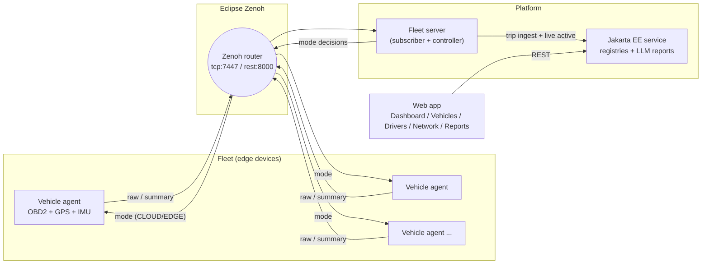

# CoreFleet

Fleet telemetry that moves between cloud and edge processing over Eclipse Zenoh, with driver reports written by an LLM.

CoreFleet was built by [Cyber Guys](https://github.com/Cyber-Guys) at the [CEI-Sphere hackathon "Code the Continuum"](https://ceisphere.eu/events/code-continuum) (Cagliari, 30 June to 1 July 2026). It answers two of the event's challenges with one product: Challenge 1 (Eclipse Zenoh and sustainable edge-cloud) and Challenge 3 (Jakarta EE, AI and the Hourglass Model). The project placed 1st and 3rd across the two challenges.

## The idea

CoreFleet is a fictional taxi and car-sharing company. It owns the cars and leases them to drivers, either taxi operators or subscribers. Each car carries an IoT device (OBD2 reader, accelerometer, GPS) that streams telemetry to the platform.

The fleet keeps growing, and the network has a fixed budget. The server decides, for each car, how it should transmit:

- `CLOUD` mode: the device sends raw telemetry every second and the server does all the processing. Best detail, most bandwidth.
- `EDGE` mode: the device aggregates locally and sends a summary every 15 seconds. Much less bandwidth and transmission energy, coarser data.

When the channel fills up, the server moves the newest cars to EDGE. The fleet ends up as a mix: as many cars in CLOUD as the channel can carry, the rest in EDGE. A web app shows the connected fleet with live telemetry and the vehicle and driver registries. On request, a Jakarta EE service asks an LLM for a report on how a driver drives and treats the company's cars.

Challenge 1 asked teams to compare cloud-only and edge-accelerated deployments and measure the bandwidth and energy saved. CoreFleet measures the bytes per second produced in each mode and estimates the energy saved with `JOULES_PER_MB`. It also switches between the two at runtime based on load. The driver reports cover Challenge 3. The numbers in them (scores, counts, grades) come from the telemetry pipeline; the LLM only writes the text around them.

## Architecture



| Component | Path | What it does | Status |
|---|---|---|---|
| Shared library | `corefleet/` | Zenoh protocol (keys, modes, codec) and `VehicleClient`, used by both the vehicles and the server. | done |
| Fleet simulator | `fleet_simulator/` | Simulates cars, drivers and trips. Each active trip is an agent that streams OBD2 and GPS data over Zenoh. | done |
| Zenoh router | `zenoh_router/` | Eclipse Zenoh router in Docker (wire `:7447`, REST `:8000`). | done |
| Fleet server | `zenoh_router/subscriber/fleet_server.py` | Subscribes to telemetry, detects congestion, publishes mode decisions, scores each trip and sends it to the registry service. | done |
| Dashboard | `webapp/` | Vue 3 control room: Dashboard, Vehicles, Drivers, Network, Reports (history), About. | done |
| Jakarta EE + LLM service | `report-service/` | Open Liberty and langchain4j: vehicle and driver registries, cached driver reports, Hourglass mapping. | done |
| Live map | | Fleet positions (Leaflet or MapLibre) from `lat`/`lon`. | planned |

## Zenoh protocol

`vid` is the vehicle id (the licence plate). All keys live under `core/fleet`.

| Key expression | Direction | Payload | Mode | Notes |
|---|---|---|---|---|
| `core/fleet/{vid}/alive` | vehicle to server | liveliness token | | Declared on ignition. Zenoh removes it (DELETE sample) when the vehicle disconnects, so crashes are detected without extra code. |
| `core/fleet/{vid}/raw` | vehicle to server | JSON telemetry | `CLOUD` | One sample per second. |
| `core/fleet/{vid}/summary` | vehicle to server | JSON aggregate | `EDGE` | One sample per 15-second window. |
| `core/fleet/{vid}/session` | vehicle to server | JSON aggregate | | Aggregate of the whole trip, published once when the trip ends. Triggers the ingest into the registries. |
| `core/fleet/{vid}/mode` | server to vehicle | `"CLOUD"` \| `"EDGE"` | | Mode for that one vehicle. Also exposed as a queryable (`core/fleet/*/mode`): a vehicle that joins mid-run reads its current mode, then subscribes for changes. |

The server subscribes with wildcards (`core/fleet/*/raw`, `core/fleet/*/summary`, `core/fleet/*/session`, `core/fleet/*/alive`), so it needs no per-vehicle subscriptions. The end-of-trip ingest runs on the `session` payload, so it does not depend on the order of liveliness events.

Every payload carries the driver (`did`, `driver_name`) and the trip id (`trip_id`). The final `session` payload also carries the driver's personal data (`driver_surname`, `driver_cf`, `driver_nationality`) and a `vehicle` snapshot (`odo_km`, `fuel_pct`, `oil_pct`, `lights`). The registries are built from these fields.

Design notes:

- Presence uses Zenoh liveliness tokens instead of a pair of `alive`/`dead` messages, so a device that crashes or loses its connection disappears on its own.
- `vid` is part of the key, so subscribers can filter and store by key expression.
- Each `core/fleet/{vid}/mode` key answers queries, so a vehicle that joins late learns its mode before the next control tick.
- Payloads are JSON for now. A CBOR or protobuf encoding is planned to measure the bandwidth difference.

## How the server splits CLOUD and EDGE

The server does not switch the whole fleet at once. It fills the channel with CLOUD vehicles up to a target and puts the rest in EDGE. On every control tick it recomputes how many vehicles can stay in CLOUD:

```
avg_raw_bytes = live EWMA of observed raw-payload size
max_cloud     = max(1, ⌊ BW_LIMIT_BYTES_S × CLOUD_SATURATION / (avg_raw_bytes × CLOUD_HZ) ⌋)

vehicles sorted by join order (oldest first):
    the first  max_cloud  → CLOUD   (1 Hz raw telemetry)
    the rest              → EDGE    (15 s aggregate)
```

The channel fills to `CLOUD_SATURATION` (default `0.8`, so 80%) of `BW_LIMIT_BYTES_S`. Older vehicles keep priority: the newest car is the first to go to EDGE when the channel is full, and it moves back to CLOUD when an older trip ends. Each change goes out on that vehicle's `core/fleet/{vid}/mode` key. `avg_raw_bytes` is measured from real payloads, so the split follows the actual byte rate.

Example with `BW_LIMIT_BYTES_S=3000`, `CLOUD_SATURATION=0.8` and `avg_raw≈248 B`: up to about 9 vehicles stay in CLOUD, so with 15 active cars the split is 9 CLOUD and 6 EDGE, logged as `MODE reassign: 9 cloud + 6 edge (max_cloud=9, avg_raw=248B)`.

Energy saved is estimated as `bytes_saved / 1e6 × JOULES_PER_MB` against a fleet that is all CLOUD. This is the main number for the Challenge 1 comparison. The server prints it every `STATS_INTERVAL_S` seconds in a `[stats] cloud=… edge=… active=…` line. `BW_LIMIT_BYTES_S`, `CLOUD_SATURATION` and `JOULES_PER_MB` are environment variables.

Each trip keeps two aggregates:

- a 15-second window, sent and reset while the vehicle is in `EDGE` mode;
- a whole-trip aggregate, used for the end-of-trip ingest that feeds the registries.

With only a few cars the whole fleet stays in CLOUD and the dashboard shows 1 Hz telemetry. To see the split and the drop in bandwidth and energy, lower `BW_LIMIT_BYTES_S`, raise `MAX_VEHICLES`, or wait for the demand cycle (`DEMAND_PERIOD_S`) to put more cars on the road.

## Telemetry data

### `raw` sample (CLOUD mode): OBD2 PIDs and GPS

| Field | Source | Unit |
|---|---|---|
| `vid`, `t` | | id, seconds |
| `did`, `driver_name`, `trip_id` | trip | driver and trip id |
| `speed_kmh` | PID 0x0D | km/h |
| `rpm` | PID 0x0C | rpm |
| `throttle` | PID 0x11 | % |
| `load` | PID 0x04 | % |
| `coolant_c` | PID 0x05 | °C |
| `fuel_lph` | PID 0x5E | L/h |
| `lat`, `lon` | GPS | deg |
| `limit_kmh` | map data | km/h |

The driver id and name are on every sample, so the server can tell who is driving right now (see `/report/api/active`).

### `summary` aggregate (EDGE window or end-of-trip session)

Distance, duration, average and maximum speed, average rpm, fuel used, L/100 km, and driving counters: harsh accelerations, harsh braking, seconds over the rev limit, seconds over the rev limit with a cold engine, idle seconds and speeding seconds.

The counters use physical thresholds (see `fleet_simulator/config.py`), so the scores come from the signals and the LLM never invents numbers. Speeding always lowers the safety score, but a fine (multa) is only recorded when the speeding lasts long enough and gets caught (`FINE_MIN_SPEEDING_S`, `FINE_CATCH_RATE`).

### Where the features are computed

This is the cloud and edge trade-off in practice. In CLOUD the device sends raw 1 Hz telemetry and the server computes every feature (`ServerTripAggregator` in `corefleet/aggregate.py`), including acceleration as `Δspeed/Δt` for harsh events. In EDGE the device computes the features and the server adds the window aggregates together. Either way the server holds one aggregate per trip and scores it, so the score does not depend on the mode. Only where the computation runs changes, and how many bytes travel. Each trip records where its stats came from (`stats_by`: `server-cloud`, `server-mixed` or `edge`). A 1 Hz feed is coarser than the device's own signal, so the server can miss some harsh spikes shorter than a second. That is the cost of moving computation off the edge.

## Cars, drivers and trips

- Cars are company assets. The fleet starts with a batch of cars and grows during the run. Odometer, fuel and oil levels and warning lights carry over between trips, and the depot refuels or services a car when it runs low.
- Drivers are people, and they come and go. New customers keep arriving, and a satisfied driver may come back for another trip. A driver who got a car back with warning lights on is less likely to return. Returning drivers take different cars. Each driver has personal data (nome, cognome, codice fiscale, nazionalità) and a baseline driving style. `RECONFIRM_RATE` and `SATISFACTION_RATE` control the churn.
- A trip is one driver taking a free car for a drive of limited length. When it ends, both go back to their pools.

The OBD2 device sits in the car, but scores and reports are about the driver, because insurance and coaching follow the person.

## Registries and driver reports (Challenge 3: Jakarta EE + LLM)

The Jakarta service (`report-service/`, Open Liberty and langchain4j, based on the Eclipse [`hourglass-template`](https://gitlab.eclipse.org/eclipse-research-labs/o-cei-project/challenge-3-jakarta-ee-hourglass/hourglass-template)) is the platform API. Every finished trip is ingested without calling the LLM. Reports are generated per driver when someone asks for one, then cached.

| Method | Path | Purpose |
|---|---|---|
| `POST` | `/report/api/trips` | Ingest a finished trip and update driver and vehicle stats. No LLM call. |
| `POST`/`GET` | `/report/api/active` | Who is driving now, with live telemetry per vehicle (speed, rpm, throttle, fuel, position). The server pushes it every ~2 s and the dashboard reads it. |
| `GET` | `/report/api/vehicles` · `/vehicles/{vid}` | Vehicle registry: total km, number of trips, fuel and oil, warning lights, last drivers. |
| `GET` | `/report/api/drivers` · `/drivers/{did}` | Driver registry: personal data, trips, km, fines and infractions, averages, repeat offences. |
| `POST` | `/report/api/drivers/{did}/report` | Generate the driver's LLM report, or return the cached one. Returns the text right away and starts the image job in the background. |
| `GET` | `/report/api/drivers/{did}/report/image` | Poll the driver's Hourglass image: `{status: pending\|ready, imageUrl}`. |
| `GET` | `/report/api/report` | History of generated reports. |
| `POST` | `/report/api/hourglass/analyze` | The template's generic Hourglass mapping (`{domain, useCase}`). |
| `GET` | `/report/api/status` | Health and configured model (no secrets). |

A driver's report is regenerated only when their data changed. The cache key is a hash of trips, km, infractions and average scores. If nothing changed, the stored report comes back with `cached: true` and no LLM call.

The platform computes the numbers: scores, counts, repeat behaviours, trend and grade. The LLM writes the prose and the Hourglass mapping (stakeholders, capabilities waist, standards groups), so the same data always gives the same scores. A fine also takes a fixed amount off the safety score (`REPORT_FINE_SAFETY_PENALTY`, default 25).

Next to the report, the service generates an image for each driver with the `image_generation` tool of the OpenAI Responses API (`OPENAI_IMAGE_MODEL`, default `gpt-5-mini`). It takes 30 to 60 seconds, so `POST …/report` returns the text at once and runs the image on a background executor. The dashboard shows a spinner and polls `…/report/image` until it gets `status: ready` with a `data:image/png;base64,…` URL. The call uses a plain `HttpClient` forced to HTTP/1.1, because HTTP/2 hangs on OpenJ9. Asking twice for the same driver does not start a second job.

The OpenAI key comes from the `OPENAI_API_KEY` environment variable, set in a `.env` file that git ignores. See `report-service/README.md`.

## Repository layout

```
.
├── corefleet/                  # Shared library (vehicle + server)
│   ├── protocol.py             # Key expressions, Mode enum, JSON codec
│   ├── client.py               # VehicleClient: liveliness, mode, publishers
│   └── config.example.json     # Zenoh Cloud client config template (TLS)
├── fleet_simulator/            # Cars + drivers + trips simulator
│   ├── __main__.py             # Entry point: python -m fleet_simulator
│   ├── config.py               # Physical constants, driver profiles, thresholds
│   ├── fleet_simulator.py      # Runner: car/driver pools + trip scheduler
│   ├── agent.py                # VehicleAgent: one trip's physics + Zenoh loop
│   ├── vehicle_simulator.py    # Per-trip physics + raw/window/session payloads
│   ├── Dockerfile
│   └── types/                  # driver_profile, driver, vehicle_state, edge_aggregate
├── zenoh_router/
│   ├── docker-compose.yaml     # Standalone router (router only)
│   └── subscriber/
│       ├── fleet_server.py     # Subscriber + congestion controller + trip ingest
│       └── Dockerfile
├── report-service/             # Jakarta EE 11 + langchain4j (Challenge 3)
│   ├── src/main/java/dukes/    # fleet/ (registries, reports) + hourglass/ + ai/
│   └── Dockerfile              # Maven build -> Open Liberty (Java 17)
├── webapp/                     # Vue 3 dashboard (Dashboard/Vehicles/Drivers/Network/Reports)
├── docker-compose.yaml         # Full stack: router + server + sim + report + webapp
├── .env.example                # OPENAI_API_KEY lives in a gitignored .env
├── requirements.txt
└── README.md
```

## Getting started

You need Docker with Docker Compose. To run the Python parts outside Docker you also need Python 3.10+ and `pip install -r requirements.txt`.

### Full stack

Put your OpenAI key in `.env` for the report service:

```bash
cp .env.example .env        # then edit .env and set OPENAI_API_KEY
docker compose up --build
```

This starts the router, fleet server, simulator, report service and dashboard. The simulator starts with a batch of cars and adds more over time, while new customers take cars for trips. The `fleet-server` logs show the `[stats]` lines with bandwidth and energy, and a `trip … ingested` line for every finished trip. In the dashboard, the Vehicles tab shows live telemetry for running trips, and in the Drivers tab you can pick a driver and press "Generate Report".

- Dashboard: http://localhost:8080
- Report service: http://localhost:9080/report/api/status
- Who is driving now: `…/report/api/active`. Drivers and vehicles: `…/report/api/drivers`, `…/report/api/vehicles`
- Router REST: http://localhost:8000 (`core/fleet/**`)

With few cars the whole fleet runs in CLOUD and the dashboard shows 1 Hz telemetry (speed, rpm, throttle, fuel). As more cars hit the road (raise `MAX_VEHICLES` or wait for the demand peak) the channel fills and the newest cars go to EDGE. The logs then show `MODE reassign: N cloud + M edge` and the `[stats] cloud=… edge=…` split, bandwidth and energy drop, and those cars' telemetry turns into 15-second aggregates. To force the split with fewer cars, lower `BW_LIMIT_BYTES_S` (for example to `1800`) or `CLOUD_SATURATION`.

Settings live in `docker-compose.yaml`:

- simulator: `START_VEHICLES`, `MAX_VEHICLES`, `SPAWN_INTERVAL_S`, `TRIP_MIN_S`/`TRIP_MAX_S`, `RECONFIRM_RATE`, `SATISFACTION_RATE`, `DEMAND_PERIOD_S`, `DEMAND_MIN`, `DURATION_S`
- server: `BW_LIMIT_BYTES_S`, `CLOUD_SATURATION`, `JOULES_PER_MB`, `FINE_MIN_SPEEDING_S`, `FINE_CATCH_RATE`, `ACTIVE_INTERVAL_S`, `STATS_INTERVAL_S`
- report service: `OPENAI_MODEL_NAME`, `OPENAI_IMAGE_MODEL`, `REPORT_FINE_SAFETY_PENALTY`

### Across several machines

The stack can run spread over several PCs, which is the "continuum" part of Challenge 1. The source code has no hardcoded hosts or IPs: every URL between services in `docker-compose.yaml` is a `${VAR:-default}` that falls back to a compose service name on a single host. To split it, copy the file to each machine, set the other machines' IPs in a `.env` (see `.env.example`), and start only the services that run there:

```bash
# Laptop B: Zenoh router
docker compose up zenoh-router

# Laptop A: simulator (points at B)
ZENOH_ROUTER=tcp/<B-IP>:7447 docker compose up fleet-simulator

# Laptop C: backend + UI (point at B)
ZENOH_ROUTER=tcp/<B-IP>:7447 ZENOH_REST_URL=http://<B-IP>:8000 \
  docker compose up fleet-server fleet-report fleet-webapp
```

The browser only talks to the webapp's nginx. It proxies `/report-api` to the report service and also proxies the Zenoh REST endpoint, with the upstreams set from `REPORT_SERVICE_URL` and `ZENOH_REST_URL` through `envsubst`. The frontend bundle contains no backend host, so the same build works on one machine or many.

### With a Zenoh router on ZettaScale Cloud

`docker-compose.cloud.yaml` runs the same services against a router hosted on ZettaScale Cloud instead of a local one. The connection uses mutual TLS, so it needs the router endpoint and the client certificates from the ZettaScale console. Copy `corefleet/config.example.json` to `corefleet/config.json`, fill in those values (git ignores this file), then:

```bash
docker compose -f docker-compose.cloud.yaml up --build
```

### Running components locally

```bash
python -m venv .venv && source .venv/bin/activate   # fish: source .venv/bin/activate.fish
pip install -r requirements.txt

# 1) router only
docker compose -f zenoh_router/docker-compose.yaml up

# 2) server  (new shell, from repo root)
ZENOH_ROUTER=tcp/localhost:7447 PYTHONPATH=. python zenoh_router/subscriber/fleet_server.py

# 3) simulator (new shell, from repo root)
ZENOH_ROUTER=tcp/localhost:7447 python -m fleet_simulator
```

## Roadmap

- [x] Simulator over Zenoh: liveliness, `mode` query and subscribe, `raw`/`summary`/`session` publish.
- [x] Fleet server: wildcard subscriptions, per-vehicle CLOUD/EDGE control (fill to `CLOUD_SATURATION`, overflow to EDGE), per-vehicle mode queryable, trip scoring and ingest, bandwidth and energy stats.
- [x] Cars, drivers and trips: car pool, driver churn (new customers and returning ones), trips of limited length, drivers moving between cars, fuel, oil, odometer and lights per car.
- [x] Live telemetry: who is driving now, with speed, rpm, throttle and fuel for each running trip; links between vehicles and drivers.
- [x] Jakarta registries and reports: vehicle and driver stats, cached driver reports, history, Hourglass mapping (langchain4j and OpenAI).
- [x] Hourglass image per driver, generated in the background with the OpenAI Responses `image_generation` tool and polled by the dashboard.
- [x] Deployment across machines through `.env` IP overrides and the webapp's nginx proxy.
- [x] Vue 3 dashboard: Dashboard, Vehicles (live trip), Drivers (with "Generate Report"), Network, Reports history.
- [x] Full Docker stack: router, server, simulator, report service and dashboard.
- [ ] Live map with fleet positions from `lat`/`lon` (Leaflet or MapLibre).
- [ ] Persistence, so registries and reports survive a restart (they are in memory today).
- [ ] CBOR or protobuf encoding to measure the bandwidth difference.

## Appendix: the hackathon challenges

The text below is quoted from the event brief.

### CEI-Sphere Hackathon: Code the Continuum

> Code the Continuum brings together students, developers, researchers, innovators, open-source communities, pilot teams and solution providers for two days of hands-on collaboration around the cloud-edge-IoT continuum.
>
> The event creates a practical space for experimentation, co-creation and exchange, where participants will work on real challenges related to open technologies, interoperability and the reuse of assets across large-scale pilot environments.

#### Challenge 1, O-CEI: Eclipse Zenoh and sustainable edge-cloud

> Participants will explore how Eclipse Zenoh can support energy-aware edge-cloud applications by comparing "cloud-only" and "edge-accelerated" deployments. Through hands-on experimentation, they will measure how optimising data flows across the continuum can reduce bandwidth usage and contribute to lower energy consumption.

- Scenarios:
  - Challenge 1.A: distributed image processing with Zenoh, comparing cloud and edge execution.
  - Challenge 1.B: geo-distributed content delivery with Zenoh and SkyFlok, comparing traffic across edge and cloud.
- Task: install the Zenoh client libraries (for example Python or Rust), run the demo repositories, adapt them with your own data, and compare edge and cloud configurations.
- Inputs: example source code and demo repositories (GitHub).
- Definition of done: at least one scenario running, with visible Zenoh message exchanges and a short explanation of the results.
- Skills: programming (Python, Rust, C/C++), basic networking and distributed systems.
- Requirements: a laptop (Windows, Ubuntu or macOS) that can run the Zenoh demos and install development tools.
- Mentors: software engineers from ZettaScale.

#### Challenge 3, Eclipse Foundation: Jakarta EE, AI and the Hourglass Model

> Proposed by the Eclipse Foundation, this challenge invites participants to design and implement a Jakarta EE application that models and analyses enterprise domains using the [Hourglass Model](https://ceisphere.eu/hourglass-model). The mapping will be supported by an external Large Language Model (LLM), integrated through modern AI engineering and agentic techniques.

- Scenario: generate the Hourglass Model for a given domain and use case.
- Task: design and implement a Jakarta EE application that models and analyses enterprise domains using the Hourglass Model, supported by an external LLM and agentic tools.
- Inputs: skeleton project, OpenAI API key, starter guides and links to resources.
- Definition of done: a complete, runnable Jakarta EE project.
- Skills: Java, Maven and general knowledge of agentic AI techniques.
- Mentor: Ivar Grimstad, Jakarta EE Developer Advocate, Eclipse Foundation.
